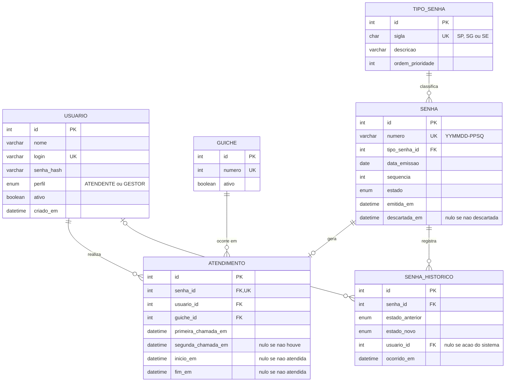

# Modelo Entidade-Relacionamento (MER)

Modelo de dados do nassauTickets, para o MySQL 8.0. Baseado nos requisitos em `docs/requirements/requisitos.md`.

## 1. Diagrama

## 2. Dicionário de dados

### USUARIO
Atendentes do sistema. O perfil `GESTOR` dá acesso a cadastros e relatórios.

| Campo | Tipo | Restrições | Descrição |
|---|---|---|---|
| id | INT | PK, auto incremento | Identificador. |
| nome | VARCHAR(100) | NOT NULL | Nome do atendente. |
| login | VARCHAR(50) | UNIQUE, NOT NULL | Nome de acesso. |
| senha_hash | VARCHAR(255) | NOT NULL | Hash da senha de acesso (nunca texto puro). |
| perfil | ENUM('ATENDENTE','GESTOR') | NOT NULL | Perfil de acesso. |
| ativo | BOOLEAN | NOT NULL, padrão verdadeiro | Se o usuário pode entrar no sistema. |
| criado_em | DATETIME | NOT NULL | Data de criação. |

### GUICHE
| Campo | Tipo | Restrições | Descrição |
|---|---|---|---|
| id | INT | PK, auto incremento | Identificador. |
| numero | INT | UNIQUE, NOT NULL | Número exibido no painel e falado no áudio. |
| ativo | BOOLEAN | NOT NULL, padrão verdadeiro | Se o guichê está em uso. |

### TIPO_SENHA
Cadastro dos três tipos de senha.

| Campo | Tipo | Restrições | Descrição |
|---|---|---|---|
| id | INT | PK, auto incremento | Identificador. |
| sigla | CHAR(2) | UNIQUE, NOT NULL | `SP`, `SG` ou `SE`. |
| descricao | VARCHAR(50) | NOT NULL | Ex.: "Senha Prioritária". |
| ordem_prioridade | INT | NOT NULL | Apoio à regra de prioridade (RN01 e RN02). |

### SENHA
| Campo | Tipo | Restrições | Descrição |
|---|---|---|---|
| id | INT | PK, auto incremento | Identificador. |
| numero | VARCHAR(12) | UNIQUE, NOT NULL | Número no padrão `YYMMDD-PPSQ`, ex.: `261125-SP001`. |
| tipo_senha_id | INT | FK → TIPO_SENHA, NOT NULL | Tipo da senha. |
| data_emissao | DATE | NOT NULL | Dia da emissão. |
| sequencia | INT | NOT NULL | Sequência por tipo, reiniciada a cada dia. |
| estado | ENUM | NOT NULL | `EMITIDA`, `AGUARDANDO`, `CHAMADA`, `CHAMADA_NOVAMENTE`, `EM_ATENDIMENTO`, `ATENDIDA`, `NAO_COMPARECEU`. |
| emitida_em | DATETIME | NOT NULL | Data e hora da emissão. |
| descartada_em | DATETIME | NULL | Preenchido quando a senha é descartada no fim do expediente. |

Restrição adicional: `UNIQUE (data_emissao, tipo_senha_id, sequencia)`, para garantir que não existam duas senhas com a mesma sequência no mesmo dia e tipo.

### ATENDIMENTO
Reúne os dados do relatório detalhado e do relatório de auditoria. Existe a partir da primeira chamada da senha.

| Campo | Tipo | Restrições | Descrição |
|---|---|---|---|
| id | INT | PK, auto incremento | Identificador. |
| senha_id | INT | FK → SENHA, UNIQUE, NOT NULL | Senha atendida (no máximo um atendimento por senha). |
| usuario_id | INT | FK → USUARIO, NOT NULL | Atendente responsável. |
| guiche_id | INT | FK → GUICHE, NOT NULL | Guichê responsável. |
| primeira_chamada_em | DATETIME | NOT NULL | Horário da primeira chamada. |
| segunda_chamada_em | DATETIME | NULL | Horário da segunda chamada, se houver. |
| inicio_em | DATETIME | NULL | Início do atendimento. Nulo se o cliente não compareceu. |
| fim_em | DATETIME | NULL | Finalização. Nulo se o cliente não compareceu. |

### SENHA_HISTORICO
Registra cada mudança de estado da senha, formando a trilha de auditoria.

| Campo | Tipo | Restrições | Descrição |
|---|---|---|---|
| id | INT | PK, auto incremento | Identificador. |
| senha_id | INT | FK → SENHA, NOT NULL | Senha afetada. |
| estado_anterior | ENUM | NULL | Estado antes da mudança (nulo na criação). |
| estado_novo | ENUM | NOT NULL | Estado depois da mudança. |
| usuario_id | INT | FK → USUARIO, NULL | Quem acionou. Nulo quando a ação é do sistema. |
| ocorrido_em | DATETIME | NOT NULL | Momento da mudança. |

## 3. Decisões de modelagem

- **Cliente anônimo (RN10 e LGPD):** não existe tabela de cliente. A senha não guarda nenhum dado pessoal.
- **Máquina de estados:** o campo `estado` da senha mostra a situação atual, e `SENHA_HISTORICO` guarda o caminho percorrido. As transições válidas são controladas pelo backend.
- **Descarte no fim do expediente:** em vez de criar um estado novo (o PDF define a máquina de estados sem ele), a senha descartada continua `AGUARDANDO` e recebe `descartada_em`. **[Proposta]**
- **Relatórios:** todos os dados dos relatórios diário, mensal, detalhado e de auditoria saem de `SENHA`, `ATENDIMENTO` e `TIPO_SENHA`. O tempo médio de atendimento é a média de `fim_em - inicio_em`. Para senhas não atendidas, os campos de atendimento ficam nulos, como pede o PDF.
- **Concorrência (RNF08):** a escolha da próxima senha deve ocorrer dentro de uma transação, com bloqueio de linha (`SELECT ... FOR UPDATE SKIP LOCKED`, disponível no MySQL 8.0), para que dois guichês nunca recebam a mesma senha.
- **Sequência diária:** o próximo valor de `sequencia` é calculado por tipo e por dia, e a restrição de unicidade impede duplicidade mesmo sob concorrência.
- **Cadastros do gestor:** `USUARIO`, `GUICHE` e `TIPO_SENHA` são as tabelas de cadastro. O conteúdo exato dos cadastros é um ponto em aberto nos requisitos.
